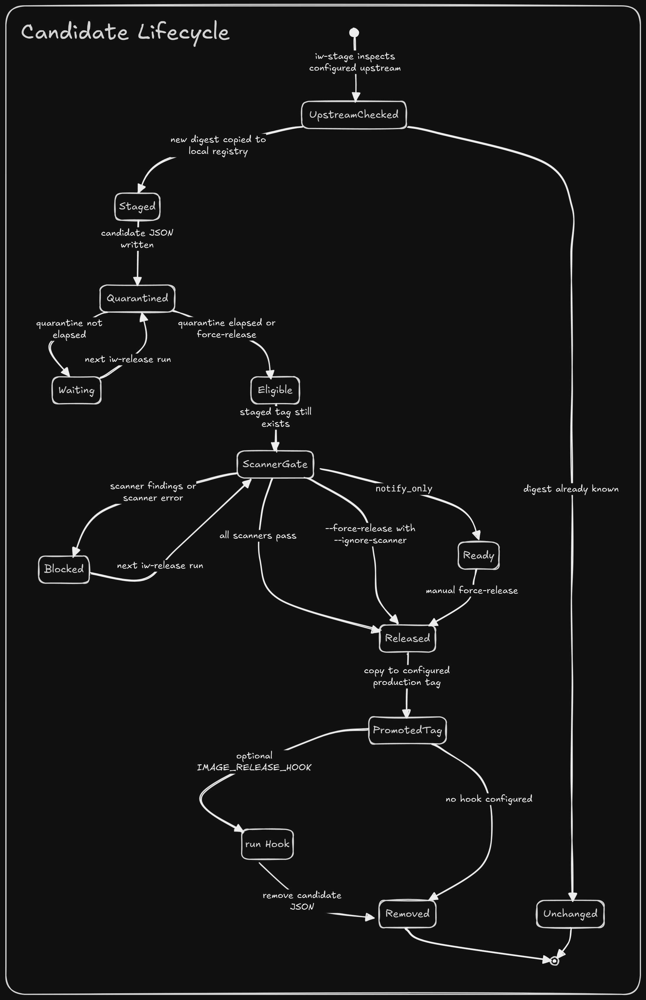
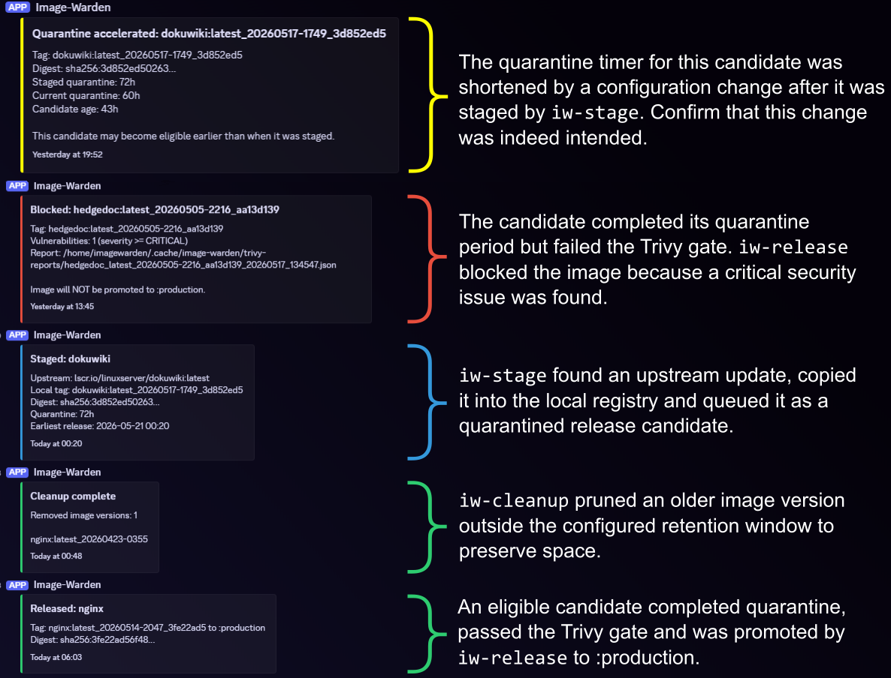

<h1 align="center">

[](LICENSE)
</h1>

Image-Warden is a small, auditable quarantine gate for container images.

It watches mutable upstream tags, mirrors new digests into a controlled local registry, holds them in quarantine (default is 72 hours), scans them and promotes only passing candidates to a local release tag such as `:production`.

If manually pinning every service to immutable digests works for you, that remains the stricter option. Image-Warden is for cases where you still want new patches, fixes and features to arrive automatically, but with a local release gate before they reach your machines.

Image-Warden is not a container management UI. It does not manage your containers, stacks, terminals or logs. It creates a low-moving-parts release channel that sits between upstream registries and your infrastructure. Anything that pulls from a registry can consume the promoted tag: [Podman `AutoUpdate=registry`](https://docs.podman.io/en/latest/markdown/podman-auto-update.1.html), Dockhand, Watchtower-style updaters, Kubernetes or plain manual pulls.

Optionally, for any of those steps you can get notifications on Discord, Telegram, Slack, Teams and/or ntfy.

## Contents

- [Contents](#contents)
- [How it works](#how-it-works)
- [Requirements](#requirements)
- [Installation](#installation)
- [Configuration](#configuration)
- [Operating Image-Warden](#operating-image-warden)
- [History and rollback](#history-and-rollback)
- [Threat model and non-goals](#threat-model-and-non-goals)
- [Container deployment](#container-deployment)
- [Uninstall](#uninstall)

## How it works

Image-Warden primarily consists of the following scripts. Each script has one job so the pipeline stays easy to inspect and debug:

| Script name | What it does |
| --- | --- |
| `iw-stage` | Compares configured upstream images with known local state. Pulls new digests into the local registry with timestamped staged tags. |
| `iw-release` | Checks quarantine timers, runs the configured scanner gate and promotes passing candidates to the configured production tag. Can also force-release one image manually. |
| `iw-scan` | Manually scans a configured local image or arbitrary image reference with the configured scanner gate. |
| `iw-cleanup` | Removes staged image versions outside retention, protects active candidates and the production tag, runs registry garbage collection and prunes old scanner reports. |

And some helpers:

| Script name | What it does |
| --- | --- |
| `iw-config` | Checks config files and converts legacy `IMAGES=()` entries to the current `image()` DSL. |
| `iw-history` | Shows the compact JSONL action history with filters for image, event, source, category, scanner and time range. |
| `iw-notify-test` | Sends a test notification to all enabled notification backends. |

You can run the scripts manually or set them up with systemd timers or cron. Example units are included in the `systemd` directory but are not installed automatically.

| Timer | Example schedule | What it does |
| --- | --- | --- |
| `iw-stage.timer` | daily | Pulls new upstream digests into local staged tags |
| `iw-release.timer` | every 6 h | Runs scanner gate and promotes clean images to the production tag |
| `iw-cleanup.timer` | weekly | Removes outdated staged tags and runs registry GC |

### Flowchart

<details>
<summary>Candidate lifecycle</summary>



</details>

## Requirements

- Linux
- an OCI Distribution-compatible registry
- Bash 4.4 or newer
- `skopeo`, `jq`, `curl`, `flock` and `sha256sum`
- Podman or Docker, ideally with a container restart tool such as [Podman `AutoUpdate=registry`](https://docs.podman.io/en/latest/markdown/podman-auto-update.1.html), [Dockhand](https://github.com/dockhand/dockhand), [What's Up Docker](https://github.com/fmartinou/whats-up-docker) or [Watchtower (Fedor fork)](https://github.com/nicholas-fedor/watchtower)
- `trivy` and/or `grype`, optional but strongly recommended

Image-Warden runs scanner binaries directly in the same environment as the `iw-*` commands. On a host install, that means Trivy and/or Grype must be installed on the host. In the provided Image-Warden container image, the scanner binaries are installed inside that container.

Image-Warden does not currently launch Trivy or Grype as separate transient scanner containers. That is intentional: scanner containers add another moving supply-chain input, plus runtime-specific networking, cache and mount behavior. If container-based scanner execution is added later, scanner images should be pinned by digest and treated as part of the trusted update path.

## Installation

```bash
git clone https://github.com/image-warden/image-warden.git
cd image-warden
bash install.sh
```

The installer checks for missing dependencies, copies scripts and libraries to `~/.local/share/image-warden/`, creates symlinks in `~/.local/bin/` and writes default config files. Existing config and secrets files are never overwritten.

Re-run `bash install.sh` at any time to update scripts after a `git pull`.

<details>
<summary>Manual installation without running install.sh</summary>

```bash
# 1. Create directories
mkdir -p ~/.local/share/image-warden/{bin,lib}
mkdir -p ~/.local/bin
mkdir -p ~/.config/image-warden
mkdir -p ~/.config/systemd/user

# 2. Install scripts and library
install -m 0755 bin/iw-*   ~/.local/share/image-warden/bin/
install -m 0644 lib/*.sh   ~/.local/share/image-warden/lib/

# 3. Create symlinks
ln -sf ~/.local/share/image-warden/bin/iw-stage    ~/.local/bin/iw-stage
ln -sf ~/.local/share/image-warden/bin/iw-release  ~/.local/bin/iw-release
ln -sf ~/.local/share/image-warden/bin/iw-scan     ~/.local/bin/iw-scan
ln -sf ~/.local/share/image-warden/bin/iw-cleanup  ~/.local/bin/iw-cleanup
ln -sf ~/.local/share/image-warden/bin/iw-config   ~/.local/bin/iw-config
ln -sf ~/.local/share/image-warden/bin/iw-history  ~/.local/bin/iw-history
ln -sf ~/.local/share/image-warden/bin/iw-notify-test  ~/.local/bin/iw-notify-test

# 4. Install config (skip if you already have one)
cp config/image-warden.conf.example ~/.config/image-warden/image-warden.conf
install -m 0600 config/secrets.example ~/.config/image-warden/secrets

# 5. Optional: Install systemd user units
install -m 0644 systemd/iw-{stage,release,cleanup}.{service,timer} \
    ~/.config/systemd/user/
systemctl --user daemon-reload
```

Ensure `~/.local/bin` is in your `PATH`:

```bash
# add to ~/.bashrc or ~/.zshrc if missing
export PATH="$HOME/.local/bin:$PATH"
```

</details>

## Configuration

### 1. Set up a staging registry

Image-Warden needs a local or remote OCI Distribution registry. If you do not already have one, use the examples in the `systemd` directory as a starting point.

**Podman (Quadlet):**

```bash
# edit Volume= paths first
vi systemd/staging-registry.container

cp systemd/staging-registry.container \
   ~/.config/containers/systemd/staging-registry.container

systemctl --user daemon-reload
systemctl --user enable --now staging-registry.service
```

**Docker (Compose):**

```bash
# edit volume paths first
vi systemd/staging-registry.compose.yml

docker compose -f systemd/staging-registry.compose.yml up -d
```

See [docs/registry-config.md](docs/registry-config.md) for `config.yml` examples, including enabling deletion for garbage collection.

### 2. Configure Image-Warden and upstream images

Edit `~/.config/image-warden/image-warden.conf`:

```bash
# Quarantine duration
QUARANTINE_HOURS=72

# Tag consumers pull from the local registry after release
PRODUCTION_TAG="production"

# Optional retry behavior for transient registry/network failures
# IW_RETRY_ATTEMPTS=3
# IW_RETRY_DELAY_SECONDS=5

# Optional executable run once per promoted image
# IMAGE_RELEASE_HOOK="/home/media/bin/iw-image-release"
# IMAGE_RELEASE_HOOK_TIMEOUT=120

# Your local registry
LOCAL_REGISTRY="localhost:5000"
LOCAL_REGISTRY_TLS_VERIFY=false   # true for HTTPS enabled registries

# Container name of the staging registry (for garbage collection in iw-cleanup)
REGISTRY_CONTAINER_NAME="staging-registry"

# Scanner gate
SCANNER_TRIVY=true
SCANNER_GRYPE=false
SCANNER_SEVERITY="CRITICAL,HIGH"

# Tracked images
image "nginx" \
  upstream="ghcr.io/advplyr/nginx:latest"

image "nginx" \
  upstream="docker.io/library/nginx:stable" \
  severity="CRITICAL" \
  quarantine_hours=48 \
  production_tag="stable" \
  platform="linux/amd64"

image "alpine" \
  upstream="docker.io/library/alpine:latest" \
  severity="CRITICAL,HIGH" \
  scanners="trivy,grype" \
  scanner_ignore="CVE-2024-3094" \
  scanner_ignore_reason="accepted risk: vulnerable binary not used" \
  notify_only=true
```

`SCANNER_TRIVY` and `SCANNER_GRYPE` enable scanner backends. All enabled scanners must pass. Grype scans currently use `--only-fixed`.

`SCANNER_SEVERITY` controls the global scanner severity threshold. Existing `TRIVY_SEVERITY` settings are still accepted as a compatibility fallback.

`scanners` is optional and scoped to that image only. If set, it overrides the global scanner toggles for that image. Use comma-separated names with no spaces, for example `scanners="trivy,grype"`.

`scanner_ignore` is optional and scoped to that image only. Use a comma-separated list of vulnerability identifiers like `CVE-2024-3094` with no spaces. Image-Warden applies it to all configured scanners. `trivy_ignore` and `grype_ignore` are optional scanner-specific overrides. Ignore reasons are used only in log messages as documentation.

`quarantine_hours` is optional and scoped to that image only. If omitted, the global `QUARANTINE_HOURS` value is used. Existing staged candidates use the current config at release time. Image-Warden logs when the current value accelerates or delays the value recorded when the candidate was staged.

`production_tag` is optional and scoped to that image only. If omitted, the global `PRODUCTION_TAG` value is used, falling back to `production`.

`platform` is optional and scoped to that image only. If omitted, the global `PLATFORM` value is used. This lets one config track different platform digests for the same upstream tag.

`IMAGE_RELEASE_HOOK` is optional and must point to an executable absolute path. It runs once for each image `iw-release` successfully promotes. Hook failures are logged and written to history but do not roll back the already-promoted image. The hook receives `IW_IMAGE_NAME`, `IW_RELEASE_FROM_TAG`, `IW_RELEASE_TO_TAG`, `IW_RELEASE_DIGEST` and `IW_LOCAL_REGISTRY` in its environment. Avoid global batch commands such as `podman auto-update` here unless your hook deduplicates them; those are usually better as a separate timer or release job follow-up.

### 3. Point your containers at the staging registry

**Podman (Quadlet):**

```ini
# Before
[Container]
Image=docker.io/library/nginx:stable
AutoUpdate=registry

# After
[Container]
Image=localhost:5000/nginx:production
AutoUpdate=registry
```

Podman detects when `iw-release` copies a new digest to the configured production tag and restarts the container automatically.

**Docker (Compose):**

```yaml
services:
  nginx:
    image: localhost:5000/nginx:production
```

For `localhost:5000` without TLS, mark the registry as insecure.

**Podman:**

```toml
[[registry]]
location = "localhost:5000"
insecure = true
```

**Docker:**

```json
{ "insecure-registries": ["localhost:5000"] }
```

### 4. Configure notifications (optional)

Edit `~/.config/image-warden/secrets`:

```bash
DISCORD_WEBHOOK_URL="https://discord.com/api/webhooks/..."
SLACK_WEBHOOK_URL="https://hooks.slack.com/services/..."
```

Edit `~/.config/image-warden/image-warden.conf`:

```bash
# One or more backends: discord slack teams telegram ntfy
NOTIFY_BACKENDS=(discord ntfy)
```

See the [secrets example](config/secrets.example) for all supported backends.

<details>
<summary>Discord notification example</summary>

<h1 align="center"></h1>

</details>

## Operating Image-Warden

Check config before staging or releasing:

```bash
iw-config check ~/.config/image-warden/image-warden.conf
```

Stage all configured images:

```bash
iw-stage
```

Stage only one configured image:

```bash
iw-stage nginx
```

Check quarantine timers, run scanner gates and release eligible images:

```bash
iw-release
```

Force-release one image after reviewing it manually:

```bash
iw-release --force-release nginx
```

Force-release one image and skip scanner gates:

```bash
iw-release --force-release nginx --ignore-scanner
```

Manually scan an image without releasing anything:

```bash
iw-scan nginx
iw-scan nginx --tag latest_20260517-1935_501b8add
iw-scan nginx:latest_20260517-1935_501b8add
iw-scan --scanner grype --severity CRITICAL docker.io/library/nginx:stable
```

Clean up old staged tags, registry layers and old scanner reports:

```bash
iw-cleanup
```

Inspect action history:

```bash
iw-history --image nginx
iw-history --source iw-release
iw-history --category scan
iw-history --image nginx --event released
iw-history --image nginx --event scan_blocked --json
```

All `iw-*` commands that load configuration accept `--config PATH` or `-c PATH`:

```bash
iw-release --config ~/.config/image-warden/test.conf --dry-run
```

Notification-capable commands also accept `--secrets PATH` when you need a different secrets file. `--config` changes only the config file; by default, secrets are still loaded from `~/.config/image-warden/secrets`.

Legacy `IMAGES=()` configuration is no longer loaded by Image-Warden. To print legacy entries as DSL blocks without modifying your config file:

```bash
iw-config legacy-to-dsl ~/.config/image-warden/image-warden.conf
```

First run behaviour: any configured image that has no local state yet is staged immediately on the next `iw-stage` run. The quarantine clock starts from that first stage.

## History and rollback

Image-Warden writes a compact JSONL action log to `~/.local/state/image-warden/events.log`. It records state-changing and security-relevant actions such as staging, scanner blocks, scanner errors, manual scanner bypasses, releases and cleanup deletions. Periodic status lines, quarantine countdowns and dry-run messages are not written there.

`iw-history` reads the selected event log into memory for filtering. For long-running installations, rotate `events.log` periodically. A simple monthly or size-based `logrotate` rule is enough for most setups:

```conf
~/.local/state/image-warden/events.log {
    monthly
    rotate 24
    compress
    missingok
    notifempty
    copytruncate
}
```

Compressed rotated logs are not searched automatically by `iw-history`; pass an uncompressed JSONL file with `--event-log PATH` when you need to inspect an older log file.

Human-readable `iw-history` output displays local time by default. Raw JSON output keeps the UTC timestamps stored in `events.log`; use `--utc` when you want the text output to show UTC too.

For manual rollback guidance, see [docs/rollback.md](docs/rollback.md).

## Threat model and non-goals

Image-Warden helps with:

- keeping container image updates automated without immediately trusting upstream `:latest`
- adding a controlled release step before new images reach your machines
- making image updates easier to inspect, scan, delay, approve or roll back manually

Image-Warden does not solve:

- malware or backdoors that scanners do not recognize
- images that turn malicious only after the quarantine window has passed
- a trusted upstream project getting compromised and still passing your policy
- insecure container settings, exposed ports, weak passwords or bad app config
- team approval workflows, user roles or enterprise compliance reporting

Image-Warden adds a safety net, not a safety guarantee. It is deliberately boring infrastructure: shell scripts, JSON state, a local registry, scanner binaries and an action log you can inspect. It's a speed bump for bad images, not a substitute for common sense, coffee and actually reading changelogs and Hacker News.

## Container deployment

Image-Warden can also run as an on-demand Docker or Podman job container. See [docs/container-deployment.md](docs/container-deployment.md).

## Uninstall

```bash
bash install.sh --uninstall
```

Config, state and cache directories are preserved. Remove them manually if no longer needed.

## Disclaimer

This project is work in progress and was written with a focus on Podman because that is what I primarily use. The scripts do work with Docker installations, but I have not tested automatic updating and restarting Docker containers extensively.

## To-do list

In no particular order:

- ~~cool logo!~~
- automatic rollback
- fully tested image-warden container deployment
- add Cosign/Notation checks
- set up TLS for local registry
- add authentication to local registry
- ~~rework Image configuration syntax~~
- Web UI
- troubleshooting document
- ~~add grype support~~
- switch over to Python
- use database instead of flat files

## License

MIT + Commons Clause - see [LICENSE](LICENSE).

Free for personal, internal and non-commercial use. Selling the software or offering it as a paid hosted service requires explicit permission from the author.
